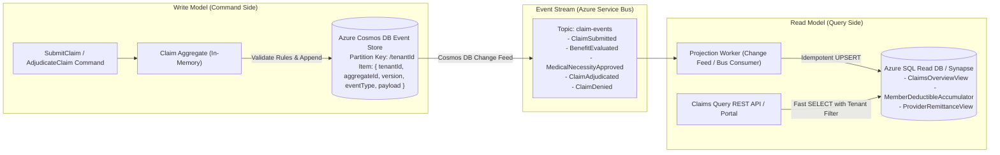

# CQRS and Event Sourcing Architecture for Claims Adjudication

## 1. Architectural Motivation

Claims adjudication in a healthcare payer value chain is characterized by:
1. **Strict Audit & Regulatory Mandates:** The Centers for Medicare & Medicaid Services (CMS) and state insurance commissioners require complete, immutable audit trails of every decision step, rule execution, and benefit adjustment.
2. **Asymmetric Read/Write Profiles:** Ingestion and adjudication require high-throughput writes (10M claims/month), whereas customer service portals, analytics pipelines, and provider dispute queries require rich, complex relational queries.
3. **Temporal Replay & Correction:** Retroactive claim adjustments ("takebacks" or re-adjudications due to contract updates) require replaying domain events against updated rule states.

To satisfy these requirements, the **Claims Adjudication Engine** is architected using **Command Query Responsibility Segregation (CQRS)** and **Event Sourcing (ES)**.

---

## 2. CQRS & Event Sourcing Architecture Diagram



---

## 3. Data Models

### 3.1 Write Model: Cosmos DB Event Store
Stored in container `claim-events` with partition key `/tenantId`:

```json
{
  "id": "tenant-a_CLM-1001_v3",
  "tenantId": "tenant-a",
  "aggregateId": "CLM-1001",
  "version": 3,
  "eventType": "ClaimAdjudicated",
  "timestamp": "2026-11-18T18:45:12.312Z",
  "metadata": {
    "correlationId": "corr-c72e45da-9812-4f11",
    "adjudicatorId": "SYS-AUTO-RULES-v2",
    "ruleSetVersion": "2026.4"
  },
  "payload": {
    "claimId": "CLM-1001",
    "memberId": "MEM-100452",
    "billedAmount": 2500.00,
    "allowedAmount": 1800.00,
    "copay": 30.00,
    "deductibleApplied": 250.00,
    "coinsurance": 304.00,
    "netPayerLiability": 1216.00,
    "status": "AdjudicatedApproved"
  }
}
```

*Optimistic Concurrency Control:* Cosmos DB `_etag` combined with strict incrementing `version` checks guarantees that concurrent adjudication workers do not produce branch conflicts on the same claim aggregate.

### 3.2 Read Model: Projected Relational Tables
Target: Azure SQL Database / Azure Synapse Analytics:

- `dbo.ClaimsSummary` (ClaimId, TenantId, MemberId, ProviderId, TotalBilled, TotalPaid, Status, AdjudicatedDate)
- `dbo.MemberAccumulators` (TenantId, MemberId, Year, DeductibleMet, OutOfPocketMet, MaxOutOfPocket)
- `dbo.RemittanceDetails` (ClaimId, TenantId, ProviderId, CheckNumber, PaymentAmount, PaymentDate)

---

## 4. Replay, Recovery & Idempotency

1. **Replay Engine:**
   When adjudication rules change or a disaster recovery scenario occurs, a projection runner scans Cosmos DB using the Change Feed processor starting from `FromBeginning` or a specific timestamp `StartTime`. The worker replays all domain events to re-populate the relational read model tables from scratch.
2. **Projection Idempotency:**
   Every event carries an increasing sequence `version`. The read model projector updates target records only if `IncomingEvent.Version > ExistingRecord.Version`.
