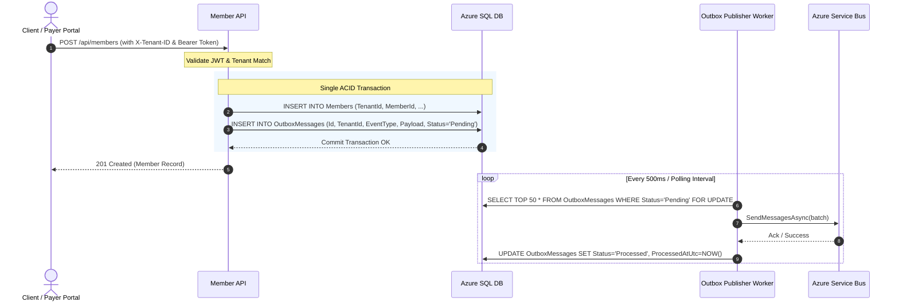

# Event-Driven Architecture Specification

## 1. Overview & Guarantees

The platform utilizes **Azure Service Bus (Premium Tier)** as its enterprise messaging backbone. The messaging design enforces:

1. **At-Least-Once Delivery with Idempotent Processing:**
   *Distributed systems cannot guarantee end-to-end exactly-once physical network delivery.* The platform achieves **effectively-once business processing** by pairing at-least-once transport delivery with idempotent consumer handlers backed by persistence-level deduplication keys.
2. **Deterministic Multi-Tenancy:**
   Every message envelope and message header explicitly includes `TenantId` and `CorrelationId`.
3. **Poison Message Isolation:**
   Failed messages retry with exponential backoff and automatically transition to a Dead-Letter Queue (DLQ) after 5 failed attempts, preserving telemetry context.

---

## 2. Topic & Subscription Topology

```
Azure Service Bus Namespace: asb-healthcare-{env}.servicebus.windows.net
├── Topic: member-events
│   ├── Partitioning: Enabled (or Premium Messaging Units)
│   ├── Subscriptions:
│   │   ├── sub-claims-ingestion-member-enrolled
│   │   │   ├── Rule: [EventType] = 'MemberEnrolled'
│   │   │   ├── MaxDeliveryCount: 5
│   │   │   ├── DeadLetteringOnMessageExpiration: true
│   │   │   └── LockDuration: 1 minute
│   │   └── sub-notifications-member-enrolled
│   │       ├── Rule: [EventType] = 'MemberEnrolled'
│   │       └── MaxDeliveryCount: 5
│
└── Topic: claim-events
    ├── Subscriptions:
    │   ├── sub-adjudication-claim-received
    │   │   ├── Rule: [EventType] = 'ClaimReceived'
    │   │   ├── MaxDeliveryCount: 5
    │   │   └── ForwardDeadLetteredMessagesTo: claim-events-dlq
    │   └── sub-analytics-claims
    │       └── Rule: 1=1 (All claim lifecycle events)
```

---

## 3. Standard Message Envelopes & Event Schemas

### 3.1 Metadata & Headers (Service Bus User Properties)
Every published message includes the following standard message application properties:

| Header Key | Type | Description |
| :--- | :--- | :--- |
| `TenantId` | `string` | The tenant identifier (e.g., `tenant-a`, `tenant-b`). Used for subscription routing rules. |
| `CorrelationId` | `string` | Distributed tracing ID linking user request to downstream events. |
| `EventType` | `string` | Name of the domain event (e.g., `MemberEnrolled`, `ClaimReceived`). |
| `SchemaVersion` | `string` | Semantic schema version (e.g., `1.0.0`). |
| `TimestampUtc` | `string` | ISO 8601 UTC timestamp of event creation. |

### 3.2 MemberEnrolled Event Payload
```json
{
  "eventId": "e9b21f3a-7d4e-4f3b-b4a1-091f2c98d41a",
  "eventType": "MemberEnrolled",
  "tenantId": "tenant-a",
  "memberId": "MEM-100452",
  "firstName": "John",
  "lastName": "Doe",
  "dateOfBirth": "1985-06-15",
  "coverageStartDate": "2026-01-01",
  "planCode": "GOLD-HMO-01",
  "status": "Active",
  "correlationId": "corr-c72e45da-9812-4f11",
  "occurredAt": "2026-11-18T18:30:00.000Z"
}
```

### 3.3 ClaimReceived Event Payload
```json
{
  "eventId": "f47ac10b-58cc-4372-a567-0e02b2c3d479",
  "eventType": "ClaimReceived",
  "tenantId": "tenant-a",
  "claimId": "CLM-2026-98104",
  "memberId": "MEM-100452",
  "providerId": "PRV-NPI-99214",
  "claimAmount": 2450.75,
  "currency": "USD",
  "claimStatus": "Submitted",
  "serviceDate": "2026-11-15",
  "diagnosisCodes": ["I10", "E11.9"],
  "procedureCodes": ["99213", "80053"],
  "correlationId": "corr-c72e45da-9812-4f11",
  "receivedAt": "2026-11-18T18:35:10.000Z"
}
```

---

## 4. Reliability & Transactional Outbox Pattern

To eliminate the two-phase commit (2PC) problem between database transactions and message broker publications:



---

## 5. Consumer Idempotency Pattern

When `ClaimsIngestionService` or downstream consumers receive messages:
1. Extract `eventId` and `tenantId` from message body/headers.
2. Check the Idempotency Store (Cosmos DB `idempotent-events` container or SQL table):
   - Key: `{tenantId}:{eventId}`.
   - If key exists and status is `Completed`, immediately acknowledge (complete) the message without re-processing.
   - If key does not exist, insert with status `Processing`.
3. Execute business logic (e.g., store claim, update local member eligibility cache).
4. Update record to `Completed` and commit Service Bus message completion (`CompleteMessageAsync`).
5. On unrecoverable error, message is abandoned with delay or dead-lettered if retry limit is reached.
