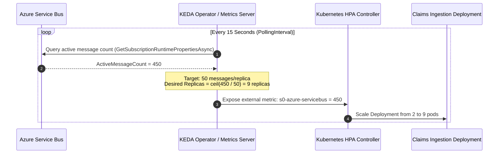

# KEDA Event-Driven Autoscaling Architecture

## 1. Overview & Motivation

Processing 10 million claims per month equates to bursts of thousands of claims per minute during peak EDI batch ingestion windows (e.g., 08:00–11:00 EST on weekdays). Traditional CPU/Memory-based Kubernetes Horizontal Pod Autoscaling (HPA) fails under these circumstances because CPU lag occurs *after* messages have already piled up, leading to high latency, queue timeouts, and breached client SLAs.

Kubernetes Event-driven Autoscaling (**KEDA**) enables the **Claims Ingestion Service** to dynamically scale proactively based on the depth of the Azure Service Bus message backlog.

---

## 2. Autoscaling Mechanics & Replica Calculation

### Replica Calculation Formula:
$$\text{DesiredReplicas} = \min\left(\text{maxReplicas}, \max\left(\text{minReplicas}, \left\lceil \frac{\text{ActiveMessageCount}}{\text{messageCountTarget}} \right\rceil\right)\right)$$

Where:
- `minReplicaCount` = **2** (maintains zero-cold-start baseline availability)
- `maxReplicaCount` = **20** (protects downstream databases and bounds cloud budget)
- `messageCountTarget` = **50** (each replica safely processes ~50 concurrent items without memory pressure)
- `pollingInterval` = **15s** (rapid response to batch spikes)
- `cooldownPeriod` = **300s (5 minutes)** (prevents thrashing/flapping when consumer drains backlog quickly)

---

## 3. Scale-Up & Scale-Down Policies

- **Scale-Up Policy:** Max of 100% pod increase or +4 pods every 15 seconds. Enables explosive scale-out within 45 seconds of a massive batch ingestion.
- **Scale-Down Policy:** Step-down rate limited to 20% reduction per 60 seconds with a 300-second stabilization window to prevent prematurely killing pods while downstream processing completes.

---

## 4. Secure Authentication via Azure Workload Identity

KEDA connects to Azure Service Bus using passwordless authentication:
1. AKS cluster has Azure Workload Identity and OIDC Issuer enabled.
2. The KEDA operator pod impersonates a dedicated Microsoft Entra ID Managed Identity (`id-keda-operator`).
3. The identity holds Azure RBAC role: `Azure Service Bus Data Receiver` and `Monitoring Reader` scoped strictly to the Service Bus namespace.
4. No shared connection strings or storage access keys exist in Kubernetes manifests.
