# Azure Synapse Analytics Read Model & HTAP Architecture

## 1. Executive Summary & Analytical Pipeline

To support executive dashboards, clinical utilization reviews, and payer financial reconciliation for 50+ payer tenants without degrading transactional ingestion performance, the platform implements a **Hybrid Transactional and Analytical Processing (HTAP)** read model.

```mermaid
flowchart LR
    subgraph OperationalPlane ["Operational Compute Plane (AKS)"]
        CI_API["Claims Ingestion Service"]
    end

    subgraph StoragePlane ["Data Tier (Cosmos DB HTAP)"]
        Cosmos_Tx["Cosmos DB Transactional Store
        - Row-oriented (JSON)
        - Latency: <10ms writes
        - Partition Key: /tenantId
        - Dedicated Ingestion RUs"]

        Cosmos_Sync["Auto-Sync (Within ~2 mins)
        Zero Transactional RU Impact!"]

        Cosmos_Analytic["Cosmos DB Analytical Store
        - Columnar format (Parquet-like)
        - Schema: WellDefined
        - TTL: Infinite (-1)"]
    end

    subgraph AnalyticalPlane ["Analytical Plane (Azure Synapse / Fabric)"]
        SynapseLink["Azure Synapse Link / Serverless SQL Pool
        - OPENROWSET(PROVIDER = 'CosmosDB')
        - On-Demand T-SQL Query Engine"]

        ReportingViews["analytics.ClaimsReportingView
        - De-identified Member Hash (No PHI)
        - Row-Level Security Predicate (RLS)"]
    end

    subgraph PresentationPlane ["Presentation Tier"]
        PowerBI["Power BI Healthcare Analytics App
        - Tenant Executive Dashboard
        - Financial Liability Heatmaps
        - Claims Trend Slicers"]
    end

    CI_API -->|High-Throughput POST| Cosmos_Tx
    Cosmos_Tx -.-> Cosmos_Sync .-> Cosmos_Analytic
    Cosmos_Analytic --> SynapseLink
    SynapseLink --> ReportingViews
    ReportingViews -->|DirectQuery with RLS| PowerBI
```



---

## 2. Integration Compatibility, Availability & Lifecycle Analysis

### 2.1 Azure Synapse Link for Cosmos DB:
- **Capability:** Azure Synapse Link creates a tight integration between Azure Cosmos DB and Azure Synapse Analytics.
- **Physical Segregation:** When `analytical_storage_ttl` is enabled (configured as `-1` in `infrastructure/terraform/modules/cosmosdb/main.tf`), Cosmos DB automatically writes data to an optimized, columnar analytical store.
- **Cost & SLA Isolation:** Analytical queries run against the analytical store and **do not consume transactional Request Units (RUs)** allocated to high-throughput claims intake.

### 2.2 Lifecycle & Modern Alternatives (Microsoft Fabric Evolution):
- **Current Lifecycle Status:** Microsoft announced Microsoft Fabric as the successor platform to Azure Synapse Analytics. Azure Synapse Serverless SQL pools continue to be supported under Long-Term Support (LTS).
- **Modern Fabric Alternative:** For organizations standardizing on Microsoft Fabric:
  - **Fabric Mirroring for Azure Cosmos DB:** Enables zero-ETL, near real-time replication of Cosmos DB data into Microsoft Fabric OneLake in open Delta Parquet format.
  - **Azure Data Factory (ADF) / Synapse Pipelines:** If Synapse Link is unavailable in specific sovereign cloud regions or restricted air-gapped subscriptions, an ADF copy activity running on a 15-minute trigger extracts updated claims via Cosmos DB Change Feed into Azure Data Lake Gen2.

---

## 3. Security, PHI Protection & Tenant Row-Level Security (RLS)

1. **No PHI in Reporting Datasets:**
   The `analytics.ClaimsReportingView` strictly excludes patient names, birth dates, phone numbers, and Social Security Numbers. Member IDs are pseudonymized using cryptographic SHA-256 hashing:
   ```sql
   CONCAT('HASH-', SUBSTRING(sys.fn_sqlvarbasetostr(HASHBYTES('SHA2_256', r.memberId)), 3, 12)) AS AnonymizedMemberKey
   ```
2. **Tenant Row-Level Security (RLS):**
   In multi-tenant reporting, an analyst or portal user from `tenant-a` must never view claims belonging to `tenant-b`. Synapse SQL Serverless enforces the security predicate:
   ```sql
   CREATE FUNCTION security.fn_tenantSecurityPredicate(@TenantId VARCHAR(50))
   ...
   ```
   Power BI Embedded passes `SESSION_CONTEXT(N'TenantId') = 'tenant-a'`, constraining returned result sets at the database engine level.

---

## 4. Power BI Dashboard Architecture & Key Visuals

### Visual 1: Executive KPI Scorecard
- **Total Ingested Claims:** Aggregated claim volume with % growth MoM.
- **Total Incurred Liability ($USD):** Sum of all submitted claim amounts.
- **Mean Claim Cost ($USD):** Average cost per procedure across tenant plans.

### Visual 2: Processing Status Matrix
- Stacked bar chart of `Submitted`, `Validated`, and `Rejected` statuses broken down by payer organization (`tenant-a`, `tenant-b`).

### Visual 3: Temporal Trends & Seasonality
- Line chart of daily submission volume identifying peak submission days (e.g. Monday morning batch surges from provider billing clearinghouses).

### Visual 4: Top Provider Network Submissions
- Treemap of billing provider NPIs by total billed amount, highlighting high-utilization clinics and potential out-of-network anomalies.
