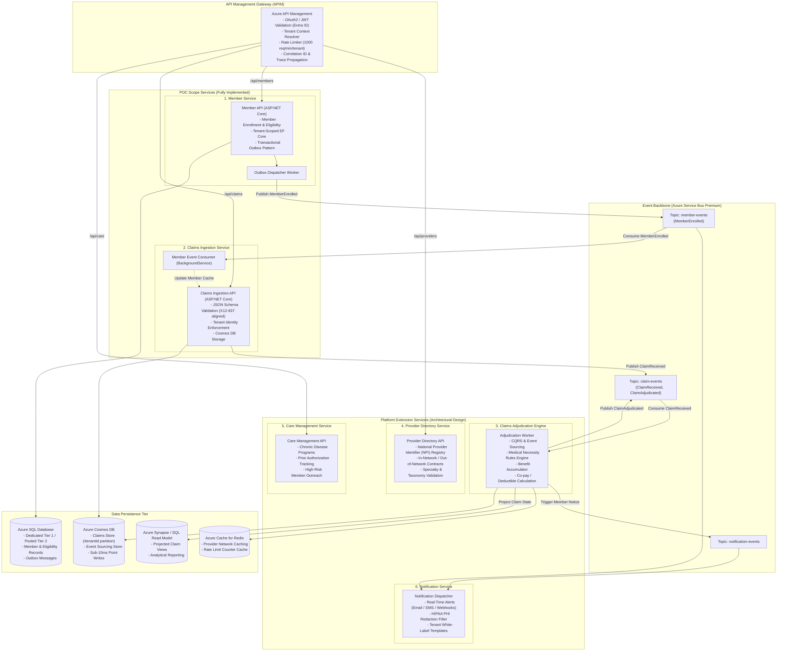

# End-to-End System Architecture

## 1. System Overview

The **Azure Multi-Tenant Healthcare Microservices Platform** provides a secure, cloud-native, and horizontally scalable backplane for health plan operations (payer value chain). It is architected to support 50+ payer organizations processing up to 10 million claims per month with sub-second ingestion, deterministic event routing, and strict tenant isolation.

---

## 2. Microservices Architecture Map

---

## 3. Microservice Specifications

### 3.1 Member Service (POC Implemented)
- **Role:** Master record management for health plan members, policy coverages, and eligibility periods.
- **Protocol:** REST API over HTTPS (`/api/members`).
- **Data Store:** Azure SQL Database using Entity Framework Core.
  - Dedicated database per Tier 1 tenant (`tenant-a-db`).
  - Shared database with Row-Level Security for Tier 2 tenants (`shared-payers-db`).
- **Reliability Pattern:** Transactional Outbox Pattern ensures atomicity between SQL persistence and message emission.
- **Events Published:** `MemberEnrolled`.

### 3.2 Claims Ingestion Service (POC Implemented)
- **Role:** High-throughput intake gateway for healthcare claims submitted by providers or clearinghouses.
- **Protocol:** REST API over HTTPS (`/api/claims`) and asynchronous Service Bus consumer.
- **Validation:** JSON Schema validation enforcing required healthcare claim structures (Member ID, Provider NPI, Service Date, Procedure Codes, Diagnosis Codes, Claim Amount).
- **Data Store:** Azure Cosmos DB (`claims-container`, Partition Key: `/tenantId`).
- **Events Consumed:** `MemberEnrolled` (maintains local cache of valid member IDs per tenant for zero-latency pre-validation).
- **Events Published:** `ClaimReceived`.
- **Autoscaling:** KEDA scaled on Service Bus topic subscription backlog.

### 3.3 Claims Adjudication Engine (Architecture / Future Extension)
- **Role:** Automated rules evaluation engine that assesses claim validity against member benefits, provider contracts, deductibles, and co-insurance.
- **Pattern:** CQRS and Event Sourcing. Every adjudication decision (Approved, Denied, Pended, Adjusted) is recorded as an immutable event in Cosmos DB.
- **Projection:** Synapse/SQL read models project the current claim state for query and claims portal operations.

### 3.4 Provider Directory Service (Future Extension)
- **Role:** Registry of credentialed healthcare providers, facilities, billing tax IDs, and network participation agreements.
- **Data Store:** Azure SQL with Azure Cache for Redis for sub-millisecond network tier lookups.

### 3.5 Care Management Service (Future Extension)
- **Role:** Identifies high-risk members based on claim diagnostic patterns and triggers care plans, case manager assignments, and disease management programs.
- **Event-Driven:** Consumes `ClaimAdjudicated` events from Service Bus.

### 3.6 Notification Service (Future Extension)
- **Role:** Enterprise notification dispatch for Explanation of Benefits (EOB), enrollment confirmation, and provider remittance notices via SendGrid and Azure Communication Services.

### 3.7 API Gateway (Azure API Management)
- **Role:** Single ingress point. Handles authentication, tenant claim extraction, tenant header validation, tenant-aware routing, rate limiting, and observability instrumentation.
