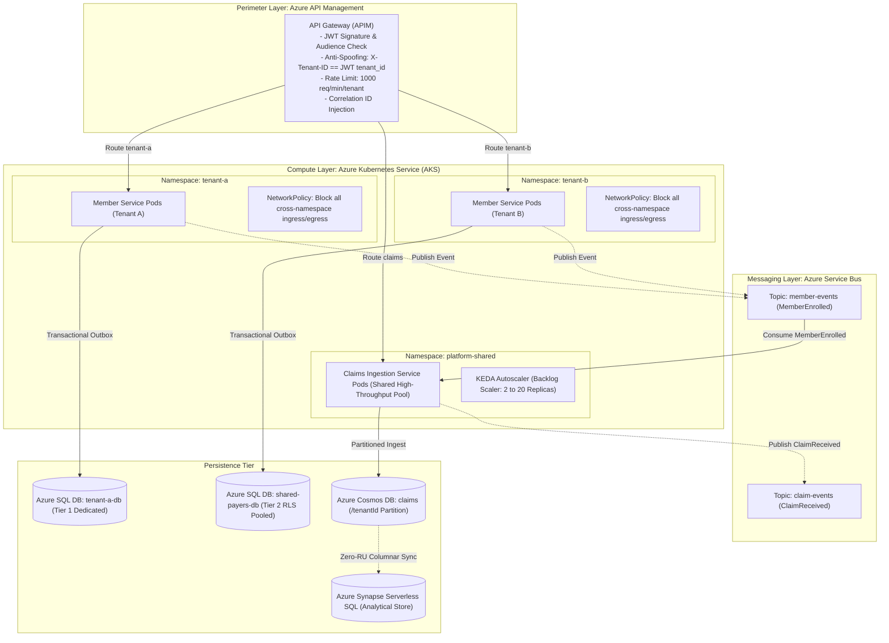

# Architecture Summary & Multi-Tenancy Strategy

## 1. Selected Hybrid Multi-Tenancy Isolation Model

The platform implements a **Practical Hybrid Isolation Architecture** balancing strict regulatory requirements (HIPAA/HITECH technical safeguards) with cloud unit economics across diverse payer profiles.

---

## 2. Multi-Layer Defense-in-Depth

1. **Perimeter Layer (APIM):** Validates authenticated Entra ID JWT claims (`tenant_id`, `tid`). If a caller supplies an unauthenticated or mismatched `X-Tenant-ID` header, APIM terminates the request immediately with HTTP 403 Forbidden.
2. **Network Layer (AKS):** Kubernetes CNI NetworkPolicies enforce default deny-all ingress and egress. Pods in `tenant-a` are blocked at the packet layer from communicating with pods in `tenant-b`.
3. **Application Context Layer (EF Core):** Microservice entities carry a `TenantId` attribute. Entity Framework Core applies a **Global Query Filter** (`e => e.TenantId == _tenantContext.TenantId`), preventing accidental cross-tenant data leakage if an application query lacks an explicit `WHERE` clause.
4. **Data Layer (Tiered SQL & Cosmos DB):**
   - Tier 1 Enterprise Payers receive dedicated Azure SQL databases with isolated backup chains and Customer-Managed Keys (CMK).
   - Tier 2 Standard Payers share pooled databases with Row-Level Security predicates (`SESSION_CONTEXT(N'TenantId') = TenantId`).
   - Claims intake utilizes Cosmos DB partitioned by `/tenantId` for sub-10ms point writes and predictable RU scaling.
5. **Messaging Layer (Transactional Outbox):** Ensures atomicity between database commits and event emissions without distributed two-phase commit overhead.
