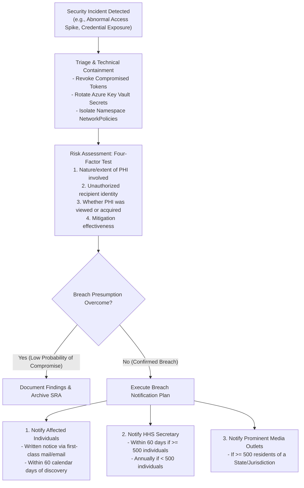

# Business Associate Agreements (BAA) & Third-Party Security Governance

## 1. Overview & Regulatory Framework

Under 45 CFR § 164.502(e) and § 164.504(e) of the HIPAA Privacy Rule, a covered entity or business associate must enter into a **Business Associate Agreement (BAA)** with any vendor, contractor, or cloud service provider that creates, receives, maintains, or transmits Protected Health Information (PHI) on its behalf.

This document establishes the BAA compliance requirements for the Azure Multi-Tenant Healthcare Microservices Platform.

---

## 2. Vendor & Service Provider BAA Coverage

### 2.1 Microsoft Azure Cloud BAA:
- **Scope:** Microsoft provides an enterprise HIPAA BAA covering all Azure Services in scope for HIPAA:
  - Azure Kubernetes Service (AKS)
  - Azure SQL Database
  - Azure Cosmos DB
  - Azure Service Bus
  - Azure API Management
  - Azure Key Vault
  - Azure Monitor / Application Insights / Log Analytics
- **Shared Responsibility:** Microsoft contractually guarantees the physical datacenter security, host hypervisors, hardware maintenance, and base infrastructure encryption under its BAA. The customer remains responsible for application authorization, tenant micro-segmentation, key management, and workforce compliance.

### 2.2 EDI Clearinghouses & Payer Integration Partners:
- **Scope:** Healthcare clearinghouses that convert provider EHR submissions into standard ANSI ASC X12 EDI 837 (Health Care Claim) and consume EDI 835 (Payment / Advice) must execute a bilateral BAA before API credentials are created.
- **Contractual Requirements:**
  1. Mandatory TLS 1.3 / TLS 1.2 communication.
  2. Proof of annual SOC 2 Type II or HITRUST certification.
  3. Strict prohibition of offshore data transmission or sub-licensing without prior approval.

### 2.3 Subcontractors & SaaS Vendors:
- Third-party SaaS providers (e.g. transactional email dispatchers, telemetry collectors) that touch PHI must sign down-stream subcontractor BAAs adhering to the same terms.
- Where a third-party service cannot sign a BAA (e.g. general email providers), the platform enforces **zero-PHI redaction** prior to dispatch, transmitting only non-PHI notification tokens.

---

## 3. HIPAA Breach Notification Protocol (§ 164.400 – § 164.414)

In the event of an unauthorized acquisition, access, use, or disclosure of unencrypted ePHI, the platform follows an automated and legal incident response protocol:



---

## 4. Technical Incident Response Protocols

1. **Automated Tenant Isolation:** If malicious behavior or token leakage is detected for a tenant, the security operator executes:
   ```bash
   kubectl annotate namespace <compromised-tenant> quarantine=true --overwrite
   ```
   The `NetworkPolicy` immediately blocks all external and internal pod ingress for that namespace.
2. **Key Vault Fast-Rotation:** Staged secrets in Azure Key Vault are rotated with a single CLI command:
   ```bash
   az keyvault secret set --vault-name kv-hlth-dev-01 --name sql-conn-<tenant> --value "<new-secure-connection-string>"
   ```
   The AKS Key Vault CSI driver propagates the updated secret to pods within 2 minutes without service restart.
