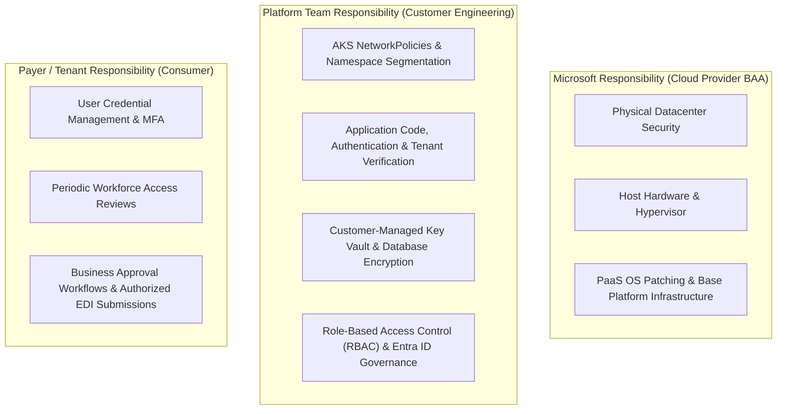

# HIPAA / HITECH Security & Compliance Control Specification

## 1. Regulatory Context & Disclaimer

> [!IMPORTANT]
> **HIPAA Compliance Disclaimer:** Deploying cloud-native security controls and encryption does not independently grant HIPAA certification. HIPAA compliance is an end-to-end organizational responsibility spanning administrative policies, physical safeguards, workforce training, business associate agreements (BAAs), continuous auditing, and technical controls. This platform implements the **technical safeguards** required under the HIPAA Security Rule (45 CFR Part 160 and Part 164, Subparts A and C).

---

## 2. Technical Safeguards Matrix (§ 164.312)

| HIPAA Specification | Regulatory Standard | Platform Implementation |
| :--- | :--- | :--- |
| **Access Control** (§ 164.312(a)(1)) | Unique User Identification | Microsoft Entra ID OAuth 2.0 / JWT integration. Client identity extracted and mapped to tenant role. |
| **Emergency Access** (§ 164.312(a)(2)(ii)) | Emergency access procedure | Azure Privileged Identity Management (PIM) with time-bound, multi-party approval and break-glass accounts. |
| **Automatic Logoff** (§ 164.312(a)(2)(iii)) | Session termination | Short-lived OAuth access tokens (15-minute expiration) with token revocation via Entra Continuous Access Evaluation (CAE). |
| **Encryption & Decryption** (§ 164.312(a)(2)(iv)) | Mechanism to encrypt/decrypt EPHI | **At Rest:** Azure SQL TDE with Customer-Managed Keys (CMK) in Azure Key Vault; Cosmos DB AES-256 service-side encryption. **In Transit:** Strict TLS 1.3 at APIM Gateway; TLS 1.2+ minimum on internal Azure PaaS endpoints. |
| **Audit Controls** (§ 164.312(b)) | Hardware, software, and/or procedural mechanisms to record and examine activity | Immutable audit logs streamed to Azure Log Analytics with Write-Once-Read-Many (WORM) storage. Retention configured for 7 years. |
| **Integrity** (§ 164.312(c)(1)) | Protect EPHI from improper alteration or destruction | Cosmos DB immutable event sourcing for claim adjudication history. SQL Server Ledger tables where tamper-evident hashing is required. |
| **Transmission Security** (§ 164.312(e)(1)) | Guard against unauthorized access to EPHI transmitted over electronic communications | Zero cross-tenant pod communication via Kubernetes `NetworkPolicy`. Private Endpoints (Azure Private Link) isolate data tiers from public internet. |

---

## 3. PHI Sanitization & Data Masking Architecture

To adhere to the principle of least privilege and prevent protected health information (PHI) leakage into observability systems:

1. **Log Sanitization Rules:**
   - **Never Logged:** Social Security Numbers (SSN), Member First/Last Names, Street Addresses, Phone Numbers, Full Claim Diagnoses, Procedure Narratives.
   - **Safe Telemetry Attributes:** `TenantId`, `CorrelationId`, `ClaimId` (opaque UUID), `ServiceDate`, `StatusCode`, `LatencyMs`.
2. **Serilog Context Enrichment:**
   ASP.NET Core microservices enrich log entries strictly with non-identifying metadata (`TenantId`, `CorrelationId`) while stripping raw HTTP request bodies on endpoints handling patient data (`POST /api/members`, `POST /api/claims`).
3. **Metric Dimensions in Prometheus/Grafana:**
   Prometheus metric labels strictly limit dimensions to `tenant_id`, `service`, `endpoint`, and `status_code`. No member IDs or medical codes are ever emitted as metric labels, preventing high-cardinality issues and regulatory violations.

---

## 4. Key Vault & Secret Rotation Lifecycle

- **Storage:** No secrets or connection strings are stored in code repositories or plain Kubernetes ConfigMaps.
- **Delivery:** Secrets are dynamically injected into microservice pods using the **Azure Key Vault Provider for Secrets Store CSI Driver** combined with **Azure Workload Identity**.
- **Rotation:** Automated secret rotation enabled (`secret_rotation_interval = "2m"`). When a database credential or Service Bus SAS key is updated in Key Vault, the CSI driver automatically rotates the mounted in-memory secret file inside the running pod without requiring pod termination.

---

## 5. Shared Responsibility Model in Azure

