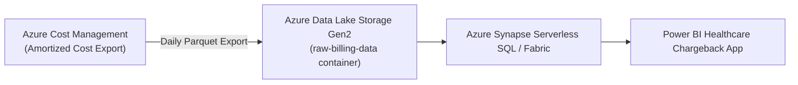

# FinOps Cost Governance & Power BI Chargeback Architecture

## 1. Tagging Taxonomy & Enforcement

To achieve transparent cost allocation and financial chargeback across 50+ payer tenants, all Azure resources are tagged via Azure Policy and Terraform:

| Tag Key | Allowed Values / Pattern | Mandatory | Description |
| :--- | :--- | :--- | :--- |
| `tenant_id` | `tenant-a`, `tenant-b`, `shared-platform` | Yes | Direct tenant ownership. Resources shared across tenants take `shared-platform`. |
| `domain` | `member`, `claims`, `gateway`, `messaging` | Yes | Healthcare domain service categorization. |
| `environment` | `dev`, `staging`, `prod` | Yes | Target deployment tier. |
| `cost_center` | `CC-PAYER-ENG-101` | Yes | Enterprise financial accounting unit. |

---

## 2. Azure Cost Export & Synapse Ingestion Pipeline

---

## 3. Power BI Report Design & Visual Layout

### Page 1: Executive Chargeback Dashboard
- **KPI Card 1:** Total Monthly Infrastructure Spend ($USD)
- **KPI Card 2:** Average Unit Cost per Claim Ingested ($USD/claim)
- **KPI Card 3:** Active Onboarded Tenants Count
- **Donut Chart:** Spend Distribution by Tenant (Direct vs Shared Allocation)
- **Stacked Bar Chart:** Monthly Spend by Service (AKS, Azure SQL, Cosmos DB, Service Bus, APIM)

### Page 2: Tenant Billing Detail & Unit Economics
- **Tenant Filter Slicer:** Dropdown to filter by `tenant_id`
- **Matrix Visual:**
  - Tenant ID
  - Monthly Ingested Claims
  - Direct Dedicated Cost
  - Allocated Shared Platform Cost
  - Total Monthly Invoice
  - Effective Cost per Claim
