# Enterprise Performance & Load Testing Report

## 1. Executive Summary

This report documents the performance engineering validation of the **Claims Ingestion Microservices Platform** under three distinct, non-equivalent workload scenarios designed to test baseline stability, sustained high-throughput, and burst recovery.

Load generation was executed using **k6** with distributed virtual users submitting synthetic healthcare claims conforming to strict JSON Schema requirements.

---

## 2. Workload Scenarios & Test Profiles

| Parameter | Scenario A: Monthly Baseline | Scenario B: High-Throughput Sustained | Scenario C: Peak Burst & Recovery |
| :--- | :--- | :--- | :--- |
| **Business Target** | 10,000,000 claims / 30-day month | 3,850 claims / minute | 15,000 claims / minute |
| **Ingestion Rate** | ~3.86 claims/sec (~231/min) | 64.2 claims/sec (~3,850/min) | 250 claims/sec (~15,000/min) |
| **Test Profile** | Constant arrival rate (5 mins) | Ramping arrival rate (10 mins) | Multi-stage explosive burst (7.75 mins) |
| **Peak Virtual Users (VUs)**| 15 VUs | 120 VUs | 480 VUs |
| **Total Claims Injected** | 1,160 claims | 32,500 claims | 51,200 claims |
| **Primary Evaluation** | Long-term memory & SLA stability | KEDA scale-out & RU consumption | Burst queue absorption & scale-in |

---

## 3. Metric Summary & Latency SLA Conformance

```mermaid
xychart-beta
    title "Latency Percentiles by Scenario (ms)"
    x-axis ["Scenario A (Baseline)", "Scenario B (Sustained)", "Scenario C (Peak Burst)"]
    y-axis "Latency (ms)" 0 --> 1200
    bar [42, 85, 210]
    bar [88, 195, 520]
    bar [145, 340, 980]
```



*(Bars represent p50, p95, and p99 from left to right).*

### Detailed Metric Matrix:

| Metric | Scenario A (Baseline) | Scenario B (Sustained) | Scenario C (Peak Burst) | SLA Target |
| :--- | :--- | :--- | :--- | :--- |
| **Actual Throughput** | 3.86 req/s (232 claims/min) | 64.1 req/s (3,846 claims/min) | 248.5 req/s (14,910 claims/min) | Target ±2% |
| **Median Latency (p50)**| 42 ms | 85 ms | 210 ms | < 300 ms |
| **95th Percentile (p95)**| 88 ms | 195 ms | 520 ms | < 750 ms |
| **99th Percentile (p99)**| 145 ms | 340 ms | 980 ms | < 1,500 ms |
| **Success Rate (%)** | 100.0% | 99.94% | 99.12% | > 98.5% |
| **HTTP 429 (Throttling)**| 0 incidents | 2 incidents (transient) | 48 incidents (auto-retried) | < 1.0% |
| **Active Pod Replicas** | 2 pods (baseline minimum) | 6 pods (KEDA scaled) | 16 pods (burst peak) | 2 to 20 pods |
| **Service Bus Backlog** | 0 to 5 messages | 40 to 180 messages | 2,400 messages (buffered) | Zero message loss |

---

## 4. KEDA Autoscaling Dynamics Analysis

### 4.1 Observations:
- **Baseline (Scenario A):** The Service Bus topic subscription backlog hovered between 0 and 5 messages. KEDA maintained the minimum replica count of **2 pods**, with CPU utilization under 12%.
- **Scale-Out Latency (Scenario B & C):**
  - In Scenario B, arrival rate ramped to 65 claims/s. Backlog crossed the `messageCount: "50"` threshold at $T+25\text{s}$.
  - KEDA metrics adapter polled the Service Bus namespace within 15 seconds, driving HPA to scale deployment from 2 to 6 pods in **42 seconds**.
  - In Scenario C (250 claims/s burst), message backlog surged to 2,400 messages within 30 seconds. KEDA scaled deployment up to **16 pods** within 65 seconds using the max scale-up policy (`selectPolicy: Max`, 100% or +4 pods).
- **Scale-In Stabilization Window:**
  - After Scenario C traffic subsided to 10 claims/s at $T+5\text{m}$, the queue backlog drained to 0 in 58 seconds.
  - Pods remained at 16 replicas during the 300-second (`cooldownPeriod`) stabilization window, preventing thrashing/flapping, then stepped down smoothly by 20% every 60 seconds back to 2 replicas.

---

## 5. Cosmos DB Request Unit (RU) & Partitioning Analysis

### 5.1 Request Unit Consumption:
- Point write for a standard claim payload (~1.2 KB) consumes **~5.8 RUs**.
- At 65 claims/second (Scenario B), transactional write demand was $\approx 377\text{ RU/s}$.
- At 250 claims/second (Scenario C), write demand spiked to $\approx 1,450\text{ RU/s}$.
- With Cosmos DB Autoscale set to 4,000 RU/s max (scaling between 400 and 4,000 RU/s), the engine scaled instantaneously without capacity exhaustion.

### 5.2 Hot Partition Risk Analysis:
> [!WARNING]
> **Hot Partition Warning:** The existing POC partitions the `claims` container by `/tenantId`. In a real-world healthcare ecosystem, a large Tier 1 payer (e.g. 8M claims/month) produces 80% of all platform volume. A single physical Cosmos DB partition is capped at **50 GB** and **10,000 RU/s**. If Tenant A bursts past 1,700 writes/sec on a single partition key, partition-level 429 throttling will occur even if total provisioned account throughput is 50,000 RU/s!

### 5.3 Mitigation for Enterprise Production:
Implement **Hierarchical Partition Keys (Subpartitioning)**:
```json
partition_key_paths = ["/tenantId", "/serviceDate"]
```
This distributes physical partitions across distinct dates per tenant, eliminating hot-spotting while preserving fast tenant-scoped point queries.

---

## 6. Bottleneck Analysis & Recommendations

1. **HTTP Client Connection Pool:**
   - Under Scenario C (250 req/s), early tests exhibited ephemeral port exhaustion on client agents when opening fresh TCP connections.
   - *Fix:* Enforce `HttpClient` connection pooling (`SocketsHttpHandler.PooledConnectionLifetime = TimeSpan.FromMinutes(5)`).
2. **Cosmos DB SDK Connection Mode:**
   - Must use `ConnectionMode.Direct` over TCP port 443/10000-20000 rather than `Gateway` mode. Gateway mode routes all traffic through intermediate web gateways, adding 8–15ms latency.
3. **Recommended Production Capacity:**
   - **AKS System Pool:** 3x `Standard_D4s_v5` nodes (Linux).
   - **Cosmos DB:** Autoscale container 1,000–10,000 RU/s with Hierarchical Partitioning (`/tenantId`, `/serviceDate`).
   - **Service Bus:** Premium Tier (1 Messaging Unit) to guarantee dedicated memory and sub-10ms broker latency without noisy neighbor interference.
   - **KEDA Scaler:** `messageCount: "75"` with `minReplicaCount: 3` and `maxReplicaCount: 25`.
